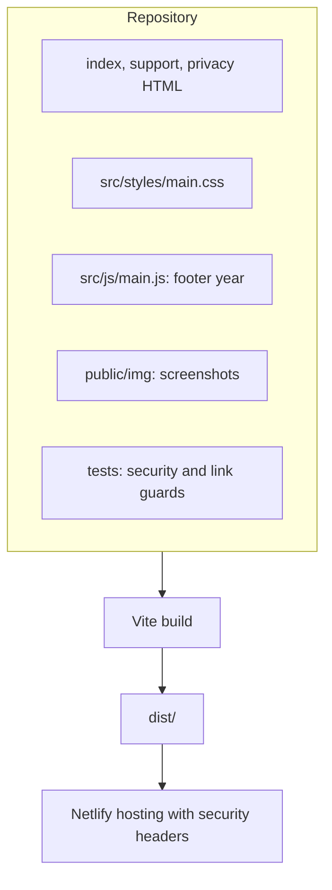
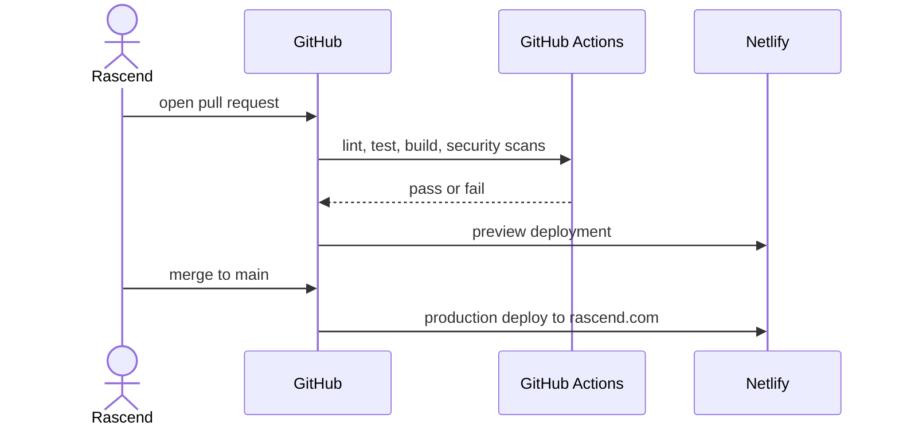
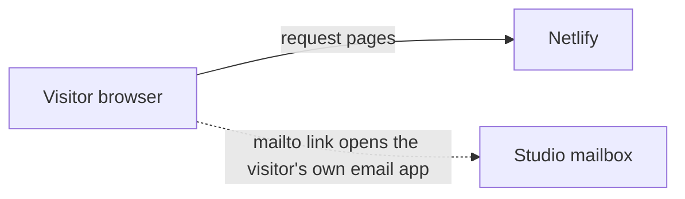

# Solution design: Rascend Website

| | |
|---|---|
| **Status** | Accepted |
| **Last updated** | 31 October 2026 |
| **Repository** | https://github.com/rascendtechnologies/rascend-website |
| **Live** | https://rascend.com |

## 1. Summary
A static website that presents Rascend Technologies, lists its apps and client projects, and provides support and privacy information. It has no backend, no accounts and no forms. Contact is by email link.

## 2. Goals and non-goals
**Goals:** give the studio's apps a credible home (store support and marketing URLs); stay fast, accessible and secure; be easy to update through pull requests.
**Non-goals:** contact forms, analytics, user accounts, a blog.

## 3. Users and key journeys
| User | Journey | Success |
|---|---|---|
| App user | Opens the support or privacy page from a store listing | Finds contact details and policy |
| Prospective client | Reads the work section, emails the studio | Understands what Rascend builds |
| Store reviewer | Opens support, marketing and privacy URLs | Pages load and match the listing |

## 4. Architecture

### 4.1 System context
```mermaid
flowchart LR
  Visitor([Visitor]) -->|HTTPS| CDN[Netlify CDN]
  CDN --> Site[Static pages and assets]
  Dev([Rascend]) -->|pull request, merge| Git[(GitHub repository)]
  Git -->|auto deploy| CDN
  DNS[VentraIP DNS] -.rascend.com.-> CDN
```

### 4.2 Components


### 4.3 Release flow


## 5. Data and privacy
The site collects no personal data. Visitors' browsers request static files only. Netlify keeps standard server logs. Links to the app stores and client sites leave the site. Email sent to the support address is received by the studio's mailbox.



## 6. Security design
- Strict Content Security Policy: same-origin scripts and styles only; no inline code.
- HSTS, no-sniff, referrer policy, frame denial and a restrictive permissions policy.
- No secrets, no backend, no stored user data.
- Dependencies are build-time only.
- Tests fail the build if inline scripts, styles or handlers appear, or if external links lack `rel="noopener"`.

## 7. Technology choices
| Area | Choice | Why |
|---|---|---|
| Build | Vite (multi-page) | Standard, fast, produces small output |
| Hosting | Netlify | Git deploys, headers, preview deployments, free tier |
| DNS | VentraIP | Where the domain is registered |
| Tests | Vitest and jsdom | Same toolchain as the build |

## 8. Non-functional requirements
Mobile first; light and dark themes; keyboard accessible; contrast of at least 4.5:1; no JavaScript required for content; under 50 KB of JavaScript.

## 9. Testing approach
Unit tests for the footer-year script. Page tests enforce the CSP-compatible structure and link safety. Security workflow runs a secret scan, dependency audit and static analysis. Headers are checked on the live site with the playbook's `check-headers.sh`.

## 10. Deployment and operations
See [runbook.md](runbook.md).

## 11. Risks and open questions
| Risk | Impact | Plan |
|---|---|---|
| A listed project goes offline | Broken link on the site | Check links quarterly; remove or update the card |
| A client withdraws permission | Must remove listing | Keep written permission with the project register |

## 12. Decisions
See [adr/](adr/).
